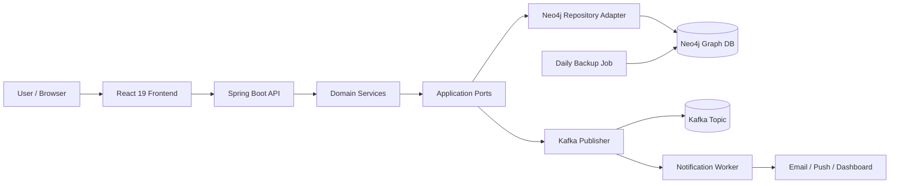

# Personal Data Store Application Architecture

## 1. Product vision

The Personal Data Store Application is a unified personal finance and lifestyle tracking platform. It treats personal data as connected graph knowledge rather than isolated rows. Users can track financial holdings, recurring expenses, notifications, and future planning with a graph-based model that supports analytics, alerts, and cross-linked insights.

## 2. Core use cases

### Use case 1: Investment tracking
- FD / fixed deposits
- Emergency fund allocation
- Stocks and equities
- Mutual funds / portfolio split
- Automatic portfolio total updates on create, update, delete, and transfer actions

### Use case 2: Expense tracking
- Rent
- Milk
- Vegetables
- Travel
- Utilities and recurring costs
- Monthly and category-based dashboards

### Use case 3: Notification engine
- Budget alerts
- Investment value changes
- Emergency-fund warning alerts
- Recurring expense anomalies

### Use case 4: Event-driven processing
- Kafka events for portfolio updates and notifications
- Async processing for analytics consumers and alerts

### Use case 5: Resilience and backup
- Daily storage backup of graph DB
- Dockerized deployment for reproducibility

## 3. High-level architecture



## 4. Design principles

### 4.1 Ports and Adapters pattern
The application isolates the business logic behind ports and adapters so the system can swap storage providers, notification channels, or event brokers without modifying domain code.

Example:
- Port: `InvestmentPort`
- Adapter: `Neo4jInvestmentRepositoryAdapter`
- Event adapter: `KafkaNotificationPublisher`

### 4.2 Singleton pattern
Spring-managed beans are singletons by default. This is ideal for shared application services like:
- notification service
- transaction summary service
- portfolio analytics engine
- user profile service

### 4.3 Repository pattern
Graph storage is accessed through repositories and adapters, abstracting the DB details from the domain service layer.

### 4.4 Event-driven architecture
Kafka handles decoupled messages such as:
- `investment.created`
- `expense.updated`
- `portfolio.summary.changed`
- `notification.triggered`

### 4.5 CQRS-style separation (optional later)
Read queries and write commands may later be split for reporting-heavy analytics.

### 4.6 Notification microservice boundary
The core ledger service remains responsible for investment and expense data management. It publishes Kafka events such as `investment.created`, `expense.created`, and `portfolio.updated`. A dedicated notification and alerting microservice consumes those topics, applies alert rules, and persists alert nodes in Neo4j for inbox and dashboard use. This isolates the side effects of alerting from the primary transaction flow.

## 5. Proposed domain model

```text
User
├── has profile
├── has investment nodes
├── has expense nodes
├── has notification rules
├── has goals and constraints

Investment
├── type: FD | STOCK | MUTUAL_FUND | EMERGENCY_FUND
├── amount
├── currentValue
├── startDate
├── maturityDate
├── relationship to user

Expense
├── category: RENT | MILK | VEGETABLE | TRAVEL | UTILITY
├── amount
├── date
├── recurring: true/false
├── relationship to user

Notification
├── type: WARNING | INFO | ALERT
├── channel: EMAIL | PUSH | IN_APP
├── triggeredAt
├── status
```

## 6. Graph modeling ideas

Use Neo4j to model personal data as a connected graph:

- `(:User)-[:HAS_INVESTMENT]->(:Investment)`
- `(:Investment)-[:OF_TYPE]->(:AssetType)`
- `(:User)-[:HAS_EXPENSE]->(:Expense)`
- `(:Expense)-[:BELONGS_TO_CATEGORY]->(:Category)`
- `(:User)-[:HAS_NOTIFICATION_RULE]->(:Rule)`
- `(:User)-[:HAS_GOAL]->(:Goal)`

This lets the platform answer questions like:
- Which categories consumed the most this month?
- How much liquidity remains after rent and essentials?
- What is the connected pattern between emergency fund and monthly expense volatility?

## 7. Future enhancements

### 7.1 Graph Data Science (GDS)
Add Neo4j Graph Data Science to forecast:
- cash flow drop probability next month
- recurring spending pattern drift
- high-risk months based on historical expense relationships

This can be built with graph algorithms such as:
- PageRank for key spending domains
- centrality for dependency analysis
- path analysis over historical dates and categories

### 7.2 Zero-knowledge encryption
For a personal data store, sensitive fields should never be readable in plain text at rest. Use:
- field-level encryption at application layer
- envelope encryption for values such as account balances or exact stock holdings
- encryption keys stored outside the database or in a KMS-backed secret store

### 7.3 Multi-tenant / household safe data
Add user and household boundaries to keep one person’s financial history separate from another member.

### 7.4 Backup and recovery
Dockerized daily dumps plus retention policy:
- daily snapshot
- weekly archive
- restore test pipeline

## 8. Recommended technology stack

### Frontend
- React 19
- Vite
- React Router
- Redux Toolkit or Zustand for global state

### Backend
- Java 21
- Spring Boot 3.4+
- Spring Web / Validation / Actuator
- Neo4j Java Driver / Spring Data Neo4j
- Kafka producer/consumer
- Spring Security + JWT later

### Data storage
- Neo4j 5.x

### Messaging
- Kafka 3.x

### Infra
- Docker Compose
- daily backup shell scripts

## 9. Security and privacy guardrails

- Sensitive values encrypted before persistence
- Least-privilege database credentials
- Only necessary endpoints exposed publicly
- Secrets in environment variables or Docker secrets
- Regular backup verification and restore drill

## 10. Suggested milestone plan

### Milestone 1
- project initialization
- basic REST APIs
- Neo4j models
- React dashboard shell

### Milestone 2
- expense and investment CRUD flows
- notification events
- Kafka pipeline

### Milestone 3
- analytics dashboards
- backup automation
- alert policies

### Milestone 4
- security hardening
- encryption for sensitive values
- graph-based forecasting

## 11. Outcome

This architecture creates a strong foundation for a world-class personal data store: secure, graph-aware, event-driven, auditable, and ready for future analytics and private data protection features.
