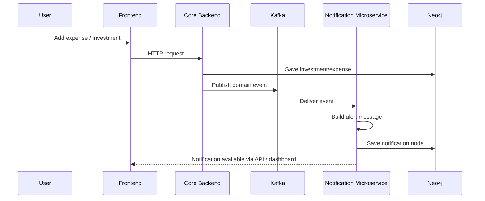

# Service Communication Flow

This document explains how the services in the Personal Data Store Application communicate with each other.

## Overview

The application follows an event-driven microservice design.

- The core backend service handles investment and expense ledger operations.
- The notification microservice is responsible for processing alerting logic.
- Kafka is the communication layer between them.
- Neo4j stores the persisted financial and notification data.

## Communication Pattern

The services do not call each other directly through Java method invocation.
Instead, they communicate asynchronously using Kafka topics.

## Step-by-step flow

### 1. User actions trigger backend logic
A user creates or updates an investment or expense from the frontend.

The request is sent to the Spring Boot backend.

Example flow:
- Frontend -> API Controller -> PortfolioService

### 2. Backend publishes a domain event
After saving the data in Neo4j, the backend publishes an event to Kafka.

Example events:
- `investment.created`
- `investment.updated`
- `expense.created`
- `expense.updated`
- `portfolio.updated`

This happens from the backend service layer, for example in `PortfolioService`.

### 3. Kafka stores the event in a topic
The event is sent to a Kafka topic such as:

- `portfolio-events`
- `personal-data-notifications`

Kafka acts as the message bus and decouples the producers and consumers.

### 4. Notification service consumes the event
The notification microservice listens to those topics using `@KafkaListener`.

Example:
- `@KafkaListener(topics = {"portfolio-events", "personal-data-notifications"})`

The consumer receives the event payload, interprets it, and creates a notification message using business rules.

### 5. Notification service applies alert logic
The notification service checks conditions like:

- expense exceeds monthly budget
- portfolio changed significantly
- investment added or updated
- recurring spending threshold reached

It builds a human-readable message such as:

- "Budget alert: Food expense exceeded the monthly budget."
- "Portfolio update: Core portfolio changed by 8.4%"

### 6. Notification is stored
The notification microservice persists the resulting alert in Neo4j as a graph node.

This creates a dedicated alert record separate from the core financial data.

---

## Sequence diagram



---

## Why Kafka is used here

Kafka is used because it provides:

- asynchronous communication
- loose coupling between services
- event replay and reliability
- scalability for future services
- easier extension for notifications, analytics, and reporting

---

## Example event payload

```json
{
  "event": "expense.created",
  "category": "Food",
  "amount": 2500,
  "monthlyBudget": 2000,
  "createdAt": "2026-09-22T12:00:00"
}
```

The notification microservice reads this payload and creates an alert if the expense exceeds the configured budget.

---

## Resulting architecture benefit

This pattern keeps the system modular:

- Core backend = data management and ledger operations
- Notification microservice = alerting and user messaging
- Kafka = event transport
- Neo4j = persistence of both domain and notification data

This separation allows future services such as:

- analytics service
- email service
- push notification service
- recommendation service

to plug into the same event stream without modifying the ledger service.
